# Wyntech Campo TJMG

Console de campo para atendimento, rollout e documentação de equipamentos de
informática do TJMG. Este repositório contém um **protótipo navegável,
autocontido e offline-first**, além da ponte de integração com o gerador
oficial de Laudo em Google Apps Script.

**Versão:** 0.7.0 · **Atualizado em:** 19/10/2026 · **Uso interno Wyntech/TJMG**

<table align="center">
  <tr>
    <td>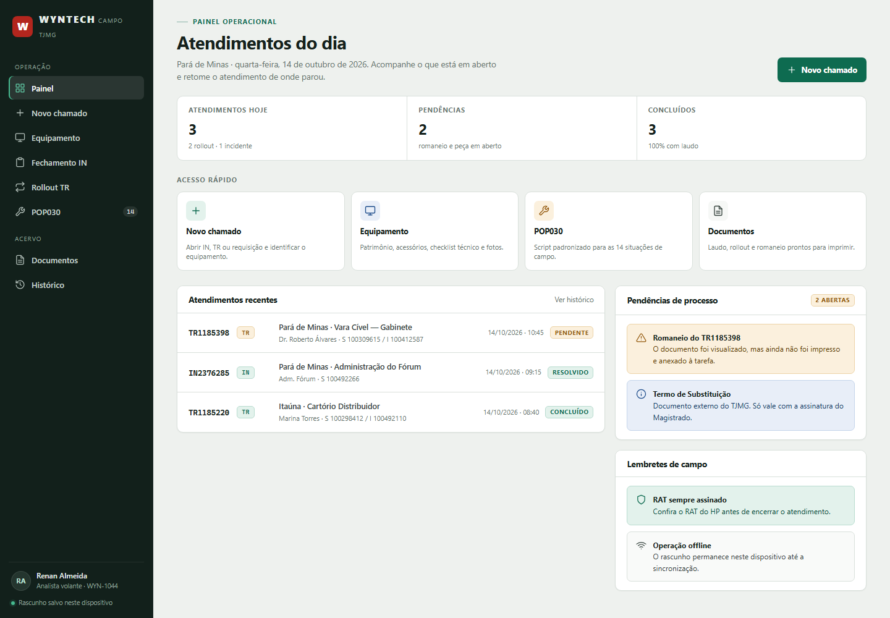</td>
    <td>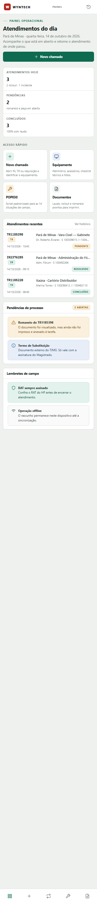</td>
  </tr>
</table>

---

## Visão geral

- **8 telas:** Painel, Chamado, Equipamento, POP030, Rollout, Fechamento,
  Documentos e Histórico.
- **Desktop e mobile:** sidebar fixa no desktop; topbar + bottom nav no mobile.
  Os grids colapsam em 1080, 900, 760, 560 e 400 px.
- **Sem frameworks e sem dependências de runtime:** HTML, CSS e JavaScript
  puros, em um único arquivo gerado (`prototipo/index.html`).
- **Persistência local:** chamado, checklist, grades, fotos e rollout ficam em
  `localStorage` (`wyntech.campo.v1`). Nada é enviado a um servidor pelo
  protótipo.
- **Documentos A4:** Laudo Técnico Unificado v5.0 (atendimento e rollout) e
  Romaneio de Substituição, com modos **Preenchido** e **Em branco**.
- **Impressão/PDF local:** ação “Imprimir / Salvar PDF” via `window.print()`,
  sem PDF falso e sem dependência de biblioteca.
- **Gerador oficial:** atalho para o Web App do Apps Script e exportação de
  rascunho JSON no formato que o próprio gerador importa.

## Capturas

### Mobile

| Painel | Chamado | Equipamento | POP030 |
|---|---|---|---|
|  | 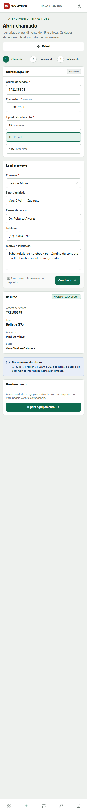 | 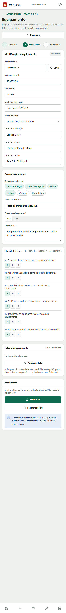 | 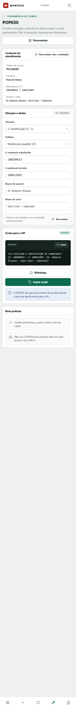 |

| Rollout | Fechamento | Documentos | Histórico |
|---|---|---|---|
| 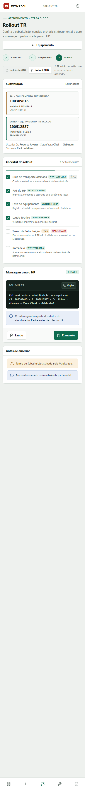 | 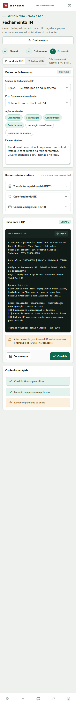 | 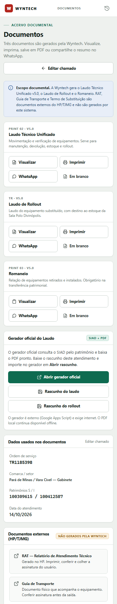 | 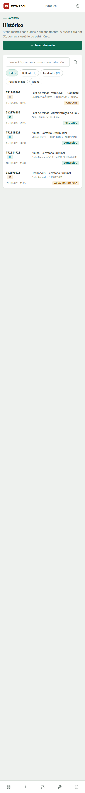 |

### Documentos

| Laudo preenchido | Laudo em branco | Romaneio preenchido | Romaneio em branco |
|---|---|---|---|
| 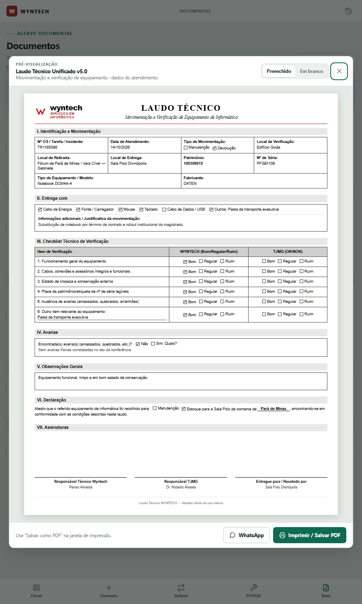 | 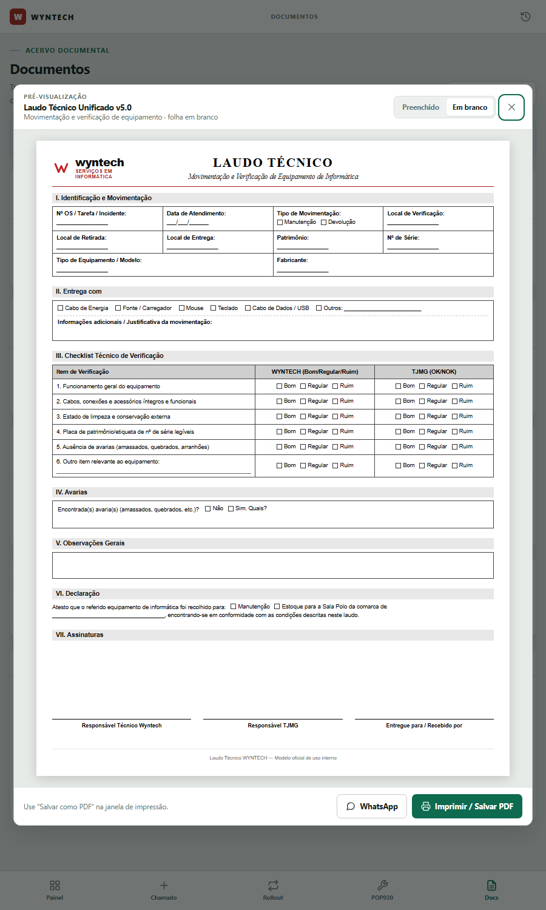 | 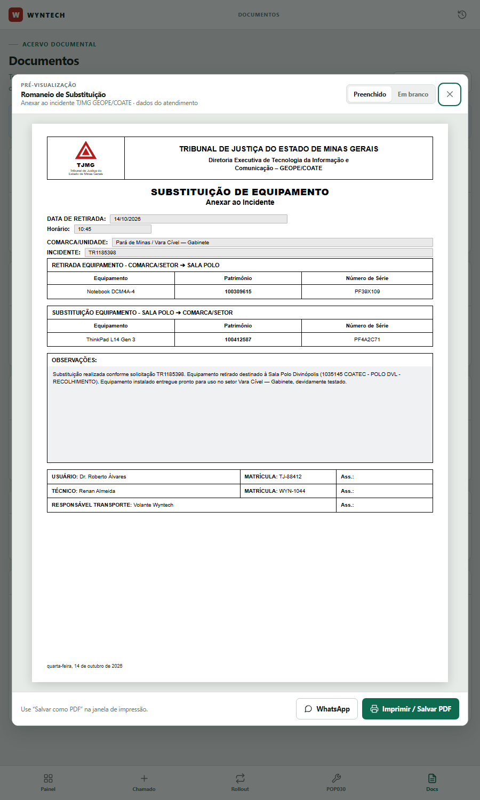 | 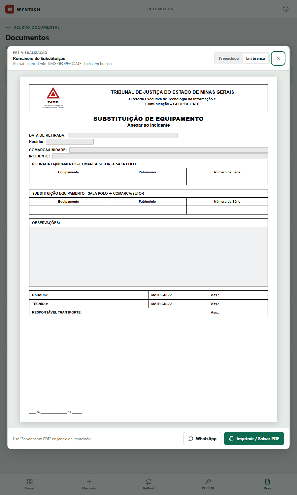 |

Os PDFs gerados na validação de impressão estão em
[`docs/exemplos/`](docs/exemplos/).

## Documentos gerados

| Documento | Gerado pelo Wyntech | Onde |
|---|---|---|
| **Laudo Técnico Unificado v5.0** | Sim — atendimento normal e rollout | Documentos → Laudo / Laudo de Rollout |
| **Romaneio de Substituição** | Sim | Documentos → Romaneio |
| **RAT** | Não — documento externo HP/TJMG | Lembrete no checklist |
| **Guia de Transferência** | Não — documento externo HP/TJMG | Lembrete no checklist |
| **Termo de Substituição** | Não — documento externo TJMG | Lembrete no checklist |

O escopo documental é intencional: o Wyntech gera o Laudo e o Romaneio; RAT,
Guia e Termo são conferidos e cobrados, mas não emitidos por este sistema.
Detalhes em [`docs/conformidade-documental.md`](docs/conformidade-documental.md).

> **Limitação visual:** os logos dos documentos são representações
> tipográficas/vetoriais (placeholders). Os arquivos oficiais do TJMG/Wyntech
> devem ser aplicados antes da produção; ver o §4.6 do documento de
> conformidade.

## Gerador oficial do Laudo (Apps Script)

A tela **Documentos** tem o painel **Gerador oficial do Laudo**:

1. Preencha o atendimento no protótipo.
2. Clique em **Rascunho do laudo** ou **Rascunho do rollout**. O navegador baixa
   um JSON `{ "versao": 1, "dados": { ... } }`.
3. Clique em **Abrir gerador oficial**.
4. No gerador, use **Abrir rascunho** e selecione o JSON baixado.
5. Confira os dados, consulte o SIAD se necessário e clique em **Gerar Laudo**.
   O PDF oficial é gerado no navegador e pode ser arquivado no Drive.

O gerador oficial é externo, consulta o SIAD pelo patrimônio e depende de
internet. O PDF local continua disponível como contingência offline.

> **Por que não há integração automática via API?**
> O formulário oficial usa `google.script.run`, que só existe dentro da página
> do Apps Script, e a implantação atual não expõe `doPost`/CORS nem lê
> parâmetros de URL para pré-preencher. A ponte por rascunho usa o recurso
> nativo **Abrir rascunho** do próprio gerador e não exige alterar o script.
> O caminho para prefill em um clique (alterando `doGet`/o HTML do script)
> está descrito em [`docs/integracao-apps-script.md`](docs/integracao-apps-script.md).

A URL do Web App fica em `prototipo/src/app.js`, na constante
`OFFICIAL_LAUDO_URL`. Se a implantação mudar, atualize esse ponto e rode o
build novamente.

## Como rodar

**Requisito:** Node.js 18+ apenas para build e preview. O protótipo em si é
estático e não precisa de servidor.

```bash
npm run build       # gera prototipo/index.html a partir de prototipo/src/
npm run preview     # http://127.0.0.1:8766/
npm run verify:draft
```

Também é possível abrir `prototipo/index.html` diretamente no navegador. O
preview evita restrições de `file://` e facilita testar no celular.

Se a porta 8766 estiver ocupada:

```powershell
$env:PORT=4173; npm run preview
```

Para abrir no celular na mesma rede:

```powershell
$env:HOST='0.0.0.0'; npm run preview
```

## Estrutura

```text
.
├─ prototipo/
│  ├─ src/
│  │  ├─ styles.css        # design system, documentos A4 e responsividade
│  │  ├─ body.html        # estrutura das 8 telas, sprites SVG e modal
│  │  └─ app.js           # estado, rotas, POP030, documentos e integração
│  ├─ build.js            # concatena as fontes em index.html
│  └─ index.html          # GERADO — não editar diretamente
├─ scripts/
│  ├─ serve.js            # preview local (sem dependências)
│  └─ verify-draft.js     # teste do contrato do rascunho oficial
├─ docs/
│  ├─ capturas/           # evidências visuais desktop e mobile
│  ├─ exemplos/           # PDFs A4 gerados na validação
│  ├─ integracao-apps-script.md
│  └─ conformidade-documental.md
├─ architecture.md
├─ CHANGELOG.md
├─ package.json
└─ LICENSE
```

## Desenvolvimento

1. Edite os arquivos em `prototipo/src/`.
2. Rode `npm run build`.
3. Recarregue o preview.

O build não usa bundler, transpilador nem dependências externas. O HTML final
é autocontido; os ícones são SVG inline e as fontes são do sistema.

**Estado local:** o protótipo usa a chave `wyntech.campo.v1`. Para começar do
zero, use “Novo chamado” ou limpe a chave no DevTools. Os dados de
demonstração são fictícios:

- OS `TR1185398` · patrimônios `100309615` / `100412587`
- Comarca `Pará de Minas` · setor `Vara Cível — Gabinete`
- Técnico `Renan Almeida` · matrícula `WYN-1044`

## Impressão e PDF

- Abra o documento e clique em **Imprimir / Salvar PDF**.
- O CSS de impressão isola a folha A4, esconde a aplicação e o modal e usa
  `@page { size: A4 portrait; margin: 10mm 8mm; }`.
- A validação no Edge/Chromium gerou **1 página A4 (594,96 × 841,92 pt)** para
  cada um dos cinco PDFs: Laudo normal, Laudo de rollout, Laudo em branco,
  Romaneio preenchido e Romaneio em branco.
- `print-color-adjust: exact` preserva as faixas cinza e a linha vermelha
  mesmo com “Gráficos de plano de fundo” desligado. Ainda assim, confira a
  prévia antes de salvar.
- Exemplos: [`docs/exemplos/`](docs/exemplos/).

## Segurança e LGPD

- Este repositório contém **dados fictícios de demonstração**. Não comite
  nomes, patrimônios, fotos ou documentos reais de atendimento.
- O Web App do Apps Script é uma implantação **externa e pública** no estado
  atual. Antes de usar dados reais, restrinja “Quem tem acesso” ao domínio
  TJMG/Google Workspace e revise o modo **Executar como**. Veja
  [`docs/integracao-apps-script.md`](docs/integracao-apps-script.md).
- O rascunho JSON baixado contém os dados do atendimento; trate-o como
  documento sensível. O protótipo não envia esse arquivo para servidor algum.
- O estado do protótipo fica no `localStorage` do dispositivo. Em máquinas
  compartilhadas, limpe os dados ao encerrar.
- A URL de implantação está no código. Se o repositório for público, trate a
  URL como exposta e restrinja/rotacione a implantação conforme a política do
  TJMG.

## Validação realizada

- Layout desktop e mobile conferido nas 8 telas (capturas em `docs/capturas/`).
- Documentos Laudo/Romaneio conferidos nos modos preenchido e em branco.
- Rascunho oficial gerado no navegador e validado contra os nomes/valores de
  campos do formulário oficial (`npm run verify:draft`).
- Impressão: 5 PDFs, todos em uma página A4, com fundos preservados.
- Não há suíte de testes E2E automatizada; a validação de UI foi manual, com
  apoio de capturas headless.

## Documentação

- [`architecture.md`](architecture.md) — arquitetura do produto e estado do
  protótipo (v0.7.0).
- [`docs/integracao-apps-script.md`](docs/integracao-apps-script.md) — desenho
  da ponte, contrato do rascunho, limitações e caminho para prefill automático.
- [`docs/conformidade-documental.md`](docs/conformidade-documental.md) — escopo
  documental, estrutura do Laudo/Romaneio e decisões de fidelidade.
- [`CHANGELOG.md`](CHANGELOG.md) — histórico de versões.

## Licença

Uso interno Wyntech/TJMG. Consulte [`LICENSE`](LICENSE).
