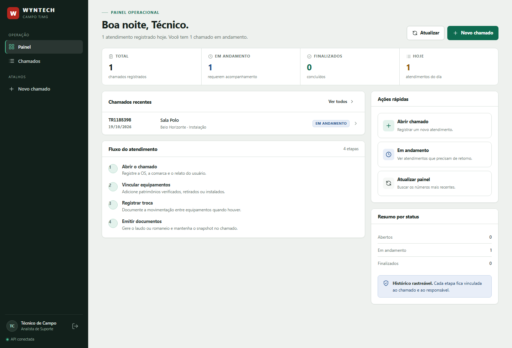
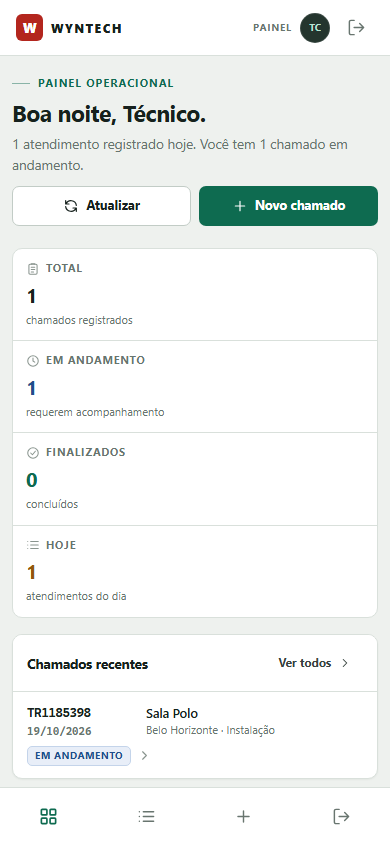

# Wyntech Campo TJMG

Console de campo para registrar atendimentos, equipamentos, trocas e documentos
de informática do TJMG. O repositório reúne o **MVP real** (API, banco,
autenticação e frontend) e o **protótipo navegável aprovado**, preservado como
referência visual e documental.

**Versão do MVP:** 0.8.0 · **Protótipo:** 0.7.0 · **Atualizado em:** 19/10/2026 · **Uso interno Wyntech/TJMG** · Node.js 24+ · SQLite · sem dependências de runtime

<table align="center">
  <tr>
    <td></td>
    <td></td>
  </tr>
</table>

---

## Início rápido

Pré-requisitos: **Node.js 24 ou superior** (o projeto usa `node:sqlite` e
`--env-file-if-exists`). Não é necessário instalar banco, PHP, Docker ou
dependências npm.

```bash
npm run setup   # cria .env, migra o SQLite e aplica o seed inicial
npm run dev     # http://127.0.0.1:3000
```

Credenciais iniciais do seed:

| Perfil | E-mail | Senha |
| --- | --- | --- |
| Administrador | `admin@wyntech.local` | `Wyntech@2026` |
| Técnico | `tecnico@wyntech.local` | `Wyntech@2026` |

> Troque as duas senhas no primeiro acesso real, pela tela **Meu perfil**.
> O seed é idempotente e não redefine senhas de usuários já existentes.

Para produção, copie `.env.example` para `.env`, ajuste `NODE_ENV=production`,
`HOST=0.0.0.0`, `COOKIE_SECURE=true`, gere um `AUTH_SECRET` forte e configure
`OFFICIAL_LAUDO_URL`. O passo a passo está em
[`docs/producao/05-operacao.md`](docs/producao/05-operacao.md) e
[`docs/producao/06-deploy-hospedagem.md`](docs/producao/06-deploy-hospedagem.md).

## O que já funciona

- Login, logout, sessão persistida em SQLite e cookie HttpOnly.
- Painel com resumo por status, chamados recentes e fluxo do atendimento.
- Chamados com busca, filtros por tipo/status/comarca/período e paginação.
- Criação e edição de chamado, mudança de status e solução aplicada.
- Equipamentos por chamado, com ação, movimentação, locais e patrimônio.
- Trocas vinculadas aos equipamentos retirado/instalado.
- Registro de snapshots de Laudo, Rollout e Romaneio no banco.
- Download do rascunho JSON `{versao:1,dados:{...}}` para o gerador oficial.
- Atalho para o Web App oficial, configurado no servidor.
- Tela **Meu perfil** com dados do usuário e troca de senha.
- Interface responsiva em desktop, tablet e celular.
- Testes de integração da API, configuração e frontend estático.

## Stack e arquitetura

| Camada | Escolha |
| --- | --- |
| Runtime | Node.js 24+ |
| HTTP | `node:http`, roteador próprio e resposta JSON `{success,data,meta?}` |
| Banco | SQLite (`node:sqlite`), migrações SQL e FKs ativas |
| Autenticação | JWT HS256 + sessão persistida + `scrypt` + cookie HttpOnly |
| Frontend | HTML, CSS e JavaScript puro em `public/` |
| Testes | `node:test` |

```text
Navegador (SPA em public/)
        │  cookie wyntech_session
        ▼
server/index.js ──► server/app.js
                       ├── arquivos estáticos + cabeçalhos de segurança
                       ├── autenticação (server/auth.js)
                       ├── roteador (server/router.js)
                       └── rotas /api/* (server/routes/)
                                 │
                                 ▼
                        data/wyntech.sqlite
```

O laudo e o romaneio **A4 continuam no gerador oficial do Apps Script**, que é
a fonte validada. O console registra o snapshot e entrega o rascunho JSON; não
duplica o renderizador A4 nesta versão. A decisão e seus motivos estão em
[`docs/producao/adr/0002-gerador-oficial-como-fonte-a4.md`](docs/producao/adr/0002-gerador-oficial-como-fonte-a4.md).

## Estrutura

```text
.
├── public/                  # MVP real: login, painel, chamados, perfil, CSS
├── server/                  # API, autenticação, banco, rotas e segurança
│   ├── migrations/          # esquema SQL versionado
│   └── routes/              # auth, chamados, comarcas e dashboard
├── scripts/                 # setup, migração, seed, reset e utilitários
├── tests/                   # API, configuração e frontend estático
├── data/                    # SQLite local (ignorado pelo Git)
├── docs/
│   ├── producao/            # documentação de operação, API, segurança e ADRs
│   ├── capturas/mvp/        # capturas do MVP real
│   └── capturas/            # capturas do protótipo aprovado
├── prototipo/               # protótipo navegável e gerador A4 de referência
├── architecture.md          # arquitetura vigente (resumo + links)
└── CHANGELOG.md
```

## Scripts

| Comando | Efeito |
| --- | --- |
| `npm run setup` | Cria `.env` se ausente, aplica migrações e seed. |
| `npm run dev` | Inicia a API com `--watch` em `127.0.0.1:3000`. |
| `npm start` | Inicia a API sem watch (produção/local). |
| `npm run db:migrate` | Aplica migrações pendentes. |
| `npm run db:seed` | Cria/atualiza apenas dados iniciais idempotentes. |
| `npm run db:reset` | Apaga o banco local e recria com seed. **Destrutivo.** |
| `npm test` | Executa todas as suítes com `node:test`. |
| `npm run build` | Gera o protótipo autocontido em `prototipo/index.html`. |
| `npm run preview` | Serve o protótipo localmente. |
| `npm run verify:draft` | Valida o contrato do rascunho oficial. |

## Configuração

As variáveis completas e os valores de produção estão documentados em
[`docs/producao/05-operacao.md`](docs/producao/05-operacao.md). As principais:

| Variável | Uso |
| --- | --- |
| `PORT`, `HOST` | Endereço do servidor. |
| `DB_PATH` | Caminho do SQLite; use disco persistente em produção. |
| `AUTH_SECRET` | Segredo HS256; obrigatório e forte em produção. |
| `TOKEN_TTL_SECONDS` | Validade da sessão (padrão 12 h). |
| `COOKIE_SECURE` | `true` atrás de HTTPS. |
| `OFFICIAL_LAUDO_URL` | Web App oficial `https://script.google.com/macros/s/.../exec`. |
| `TRUST_PROXY` | Confiar em `X-Forwarded-For` apenas atrás de proxy conhecido. |
| `LOGIN_RATE_LIMIT_MAX` | Tentativas de login por IP/e-mail em 15 min. |

`OFFICIAL_LAUDO_URL` não fica hardcoded no repositório. Quando ausente, o
botão do gerador aparece desabilitado; quando presente, é validado para aceitar
somente HTTPS em `script.google.com` com caminho `/macros/s/.../exec`.

## API e documentação

- [Visão geral da produção](docs/producao/README.md)
- [Arquitetura detalhada](docs/producao/02-arquitetura.md)
- [Banco de dados](docs/producao/03-banco-de-dados.md)
- [API](docs/producao/04-api.md)
- [Operação e configuração](docs/producao/05-operacao.md)
- [Deploy e hospedagem](docs/producao/06-deploy-hospedagem.md)
- [Segurança](docs/producao/07-seguranca.md)
- [Testes](docs/producao/08-testes.md)
- [Integração com o gerador oficial](docs/producao/10-integracao-gerador.md)
- [Frontend](docs/producao/11-frontend.md)
- [Roadmap](docs/producao/09-roadmap.md)
- [Arquitetura histórica PHP/MySQL](docs/producao/historico/arquitetura-plano-php-mysql.md)

## Segurança e limites conhecidos

- Troque as senhas do seed e o `AUTH_SECRET` antes de dados reais.
- O Apps Script deve ser publicado com acesso restrito ao domínio TJMG e
  “Executar como” revisado. Isso depende de ação no console do Google.
- A URL do Web App é entregue pela API somente após autenticação e não está
  versionada; ainda assim, quem tem acesso ao console pode vê-la.
- Os logos oficiais TJMG/Wyntech ainda não estão no repositório; a interface
  usa a marca textual e placeholders neutros.
- A hospedagem compartilhada ainda não foi definida. O provedor precisa
  suportar **Node.js 24**, `node:sqlite` e **disco persistente** para o arquivo
  SQLite.
- Upload de fotos, anexos e administração de usuários estão no roadmap, não no
  MVP atual.

## Protótipo aprovado

O protótipo em `prototipo/` preserva as 8 telas, o layout validado, os templates
A4 de Laudo/Romaneio e os PDFs de referência. Para abri-lo:

```bash
npm run build
npm run preview
```

O atalho do gerador no protótipo lê a chave
`localStorage.wyntech.officialLaudoUrl`; sem ela, o link fica desabilitado.
Capturas e detalhes do protótipo estão em
[`docs/conformidade-documental.md`](docs/conformidade-documental.md) e
[`docs/integracao-apps-script.md`](docs/integracao-apps-script.md).

## Licença

Uso interno Wyntech/TJMG. Projeto privado, sem licença de distribuição pública.
