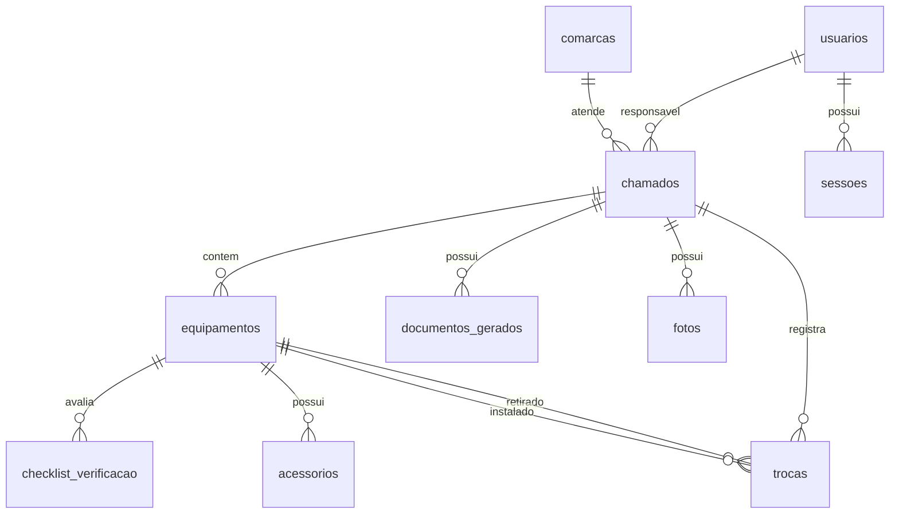

# 03 — Banco de dados

## 1. Visão

- SGBD: **SQLite** via `node:sqlite`.
- Arquivo padrão: `data/wyntech.sqlite` (ignorado pelo Git).
- Migrações: `server/migrations/*.sql`, aplicadas em ordem e registradas em
  `_migracoes`.
- Chaves estrangeiras ativas (`PRAGMA foreign_keys = ON`).
- Datas de negócio em `AAAA-MM-DD`; timestamps em ISO 8601 UTC (`...Z`).
- Testes usam banco em memória (`:memory:`).

## 2. Relações



## 3. Tabelas

### `usuarios`

| Campo | Tipo | Observação |
| --- | --- | --- |
| `id` | INTEGER PK | autoincremento |
| `nome` | TEXT | obrigatório |
| `email` | TEXT | único, `COLLATE NOCASE` |
| `senha_hash` | TEXT | `scrypt$...`; nunca retornado pela API |
| `matricula` | TEXT | opcional |
| `cargo` | TEXT | padrão `Técnico` |
| `papel` | TEXT | `TECNICO` ou `ADMIN` |
| `ativo` | INTEGER | 1/0 |
| `criado_em`, `atualizado_em` | TEXT | UTC |

### `sessoes`

| Campo | Tipo | Observação |
| --- | --- | --- |
| `id` | INTEGER PK | |
| `usuario_id` | FK → `usuarios` | `ON DELETE CASCADE` |
| `jti` | TEXT | único; identifica o JWT |
| `criado_em`, `expira_em` | TEXT | UTC |
| `revogado_em` | TEXT | nulo enquanto válida |
| `ip`, `user_agent` | TEXT | auditoria básica |

### `comarcas`

`id`, `nome` (único), `cidade`, `endereco`, `ativa` (1/0), `criado_em`.
O seed cria 8 comarcas: Pará de Minas, Divinópolis, Belo Horizonte, Contagem,
Betim, Sete Lagoas, Itaúna e Formiga.

### `chamados`

Campos principais: `usuario_id`, `comarca_id`, `numero_os`, `tipo`, `setor`,
`pessoa_contato`, `matricula_contato`, `telefone_contato`, `defeito_relatado`,
`solucao_aplicada`, `observacoes`, `status`, `data_atendimento`.

- `tipo`: `IN`, `TR` ou `REQ`.
- `status`: `ABERTO`, `EM_ANDAMENTO` ou `FINALIZADO`.
- `excluido_em`: exclusão lógica; listagens e dashboard filtram nulos.
- `ON DELETE RESTRICT` para usuário/comarca: evita perder o histórico.

### `equipamentos`

| Campo | Observação |
| --- | --- |
| `chamado_id` | FK `ON DELETE CASCADE` |
| `patrimonio`, `serial` | identificação; indexados |
| `tipo_equipamento`, `modelo`, `fabricante` | descrição |
| `acao` | `VERIFICACAO`, `RETIRADA`, `INSTALACAO`, `TROCA` |
| `tipo_movimentacao` | `MANUTENCAO`, `DEVOLUCAO` ou nulo |
| `local_verificacao`, `local_retirada`, `local_entrega` | locais do atendimento |

`local_entrega` tem default `Sala Polo Divinópolis`.

### `checklist_verificacao` e `acessorios`

Tabelas normalizadas por equipamento, previstas para a evolução do laudo.
O MVP atual expõe checklist vazio na API e ainda não possui tela de edição.
`checklist_verificacao` aceita avaliações `BOM`, `REGULAR`, `RUIM` para Wyntech
e TJMG; `acessorios` registra tipo, presença e descrição de “outros”.

### `trocas`

Liga `equip_retirado_id` e `equip_instalado_id` ao chamado, com locais, data e
observações. As FKs de equipamento usam `ON DELETE SET NULL` para preservar a
troca mesmo se um equipamento for removido. A API exige ao menos um dos dois
equipamentos e ambos devem pertencer ao chamado.

### `documentos_gerados`

| Campo | Observação |
| --- | --- |
| `chamado_id` | FK `ON DELETE CASCADE` |
| `tipo_doc` | `LAUDO`, `LAUDO_ROLLOUT`, `ROMANEIO` |
| `gerado_em` | timestamp UTC |
| `dados_json` | snapshot completo em JSON |

O snapshot do MVP tem o formato `{versao:1,dados:{...}}`; a API o devolve como
objeto em `dados`. O conteúdo não é usado para reconstruir o chamado.

### `fotos`

Tabela reservada para anexos (`caminho_arquivo`, descrição, tamanho). **Não há
upload nem endpoint nesta versão**; a tabela existe para evolução futura.

### `_migracoes`

Controle interno do runner: nome do arquivo e data de aplicação.

## 4. Índices

Há índices para usuário, comarca, número de OS, status e data dos chamados;
chamado/patrimônio/serial de equipamentos; chamado em trocas, fotos e
documentos; usuário e expiração de sessões.

## 5. Consultas e paginação

- Listagem: filtros combináveis por tipo, status, comarca, `data_de`, `data_ate`
  e busca textual (`numero_os`, `setor`, `pessoa_contato`, `defeito_relatado`).
- Paginação: `page` (>=1) e `limit` (1..100); metadados `{page, limit, total}`.
- Ordenação de chamados: `data_atendimento DESC, id DESC`.
- Dashboard: até 5 recentes, ordenados por `atualizado_em DESC, id DESC`.

## 6. Migrações

```bash
npm run db:migrate
```

O runner lê os arquivos em ordem alfabética, executa cada um em transação e
registra em `_migracoes`. Para criar uma migração, adicione
`server/migrations/002_descricao.sql`; nunca altere uma migração já aplicada em
produção.

## 7. Backup e restauração

No ambiente local, com a aplicação parada, copie o arquivo `.sqlite`. Com a
aplicação rodando, use `VACUUM INTO` para gerar uma cópia consistente:

```bash
node -e "const {DatabaseSync}=require('node:sqlite');const db=new DatabaseSync('data/wyntech.sqlite');db.exec(\"VACUUM INTO 'backup/wyntech-2026-10-19.sqlite'\");db.close()"
```

Na VPS, o banco fica em `/var/lib/wyntech/wyntech.sqlite` e o backup lógico é
feito pelo script
[`deploy/backup-wyntech.sh`](../../deploy/backup-wyntech.sh), com checksum e
retenção. Veja o [runbook da VPS](12-deploy-vps-1gb.md#9-backup-e-restauração).

Restauração: pare o processo, substitua o arquivo (e remova `-wal`/`-shm`
antigos), confira permissões e suba novamente. Teste a restauração em uma cópia
antes de usar dados reais.

## 8. Retenção e LGPD

- O MVP não possui rotina automática de expurgo.
- Defina prazo de retenção de chamados, documentos e logs conforme a política
  do TJMG/Wyntech.
- Evite colocar dados pessoais desnecessários em `observacoes` e nomes de
  arquivos.
- Backups também contêm dados pessoais e devem ser protegidos e descartados com
  segurança.
